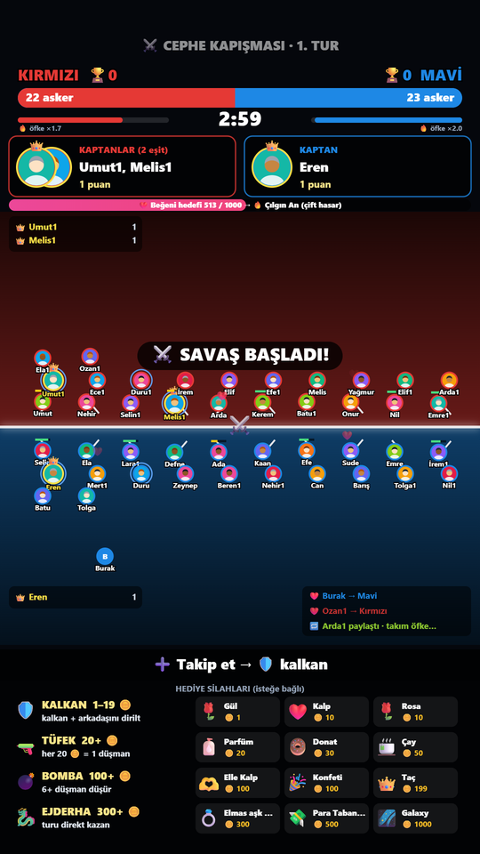
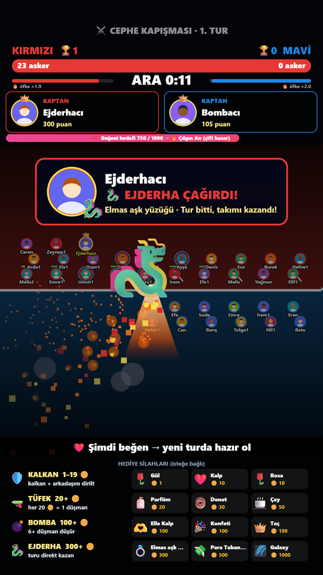
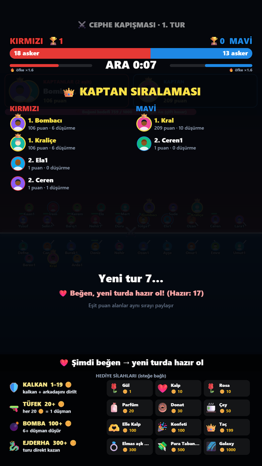

# ⚔️ Cephe Kapışması: TikTok LIVE için ücretsiz takım savaşı oyunu

İzleyicilerin **beğeniyle savaşa katıldığı**, hediyelerin **silaha dönüştüğü** dikey (1080×1920) bir canlı yayın
oyunu. Kendi bilgisayarında çalışır. Ücretli bir servis, abonelik ya da API anahtarı gerektirmez. Açık kaynaktır
(MIT).

<p align="center">
  
  
  
  
</p>

> Görüntüler örnek verilerle (demo izleyicileri) üretildi; gerçek kişi içermez.

## Nasıl oynanır?

| İzleyici ne yapar | Ne olur |
|---|---|
| ❤️ **Beğeni** atar | Profil fotoğrafı ve adıyla bir asker olarak savaşa girer (az kişili takıma) |
| 💬 **1** ya da **2** yazar | Kırmızı ya da Mavi takımı seçer |
| ❤️ Oyundayken beğenmeye devam eder | Askeri iyileşir, takımının hasarı (öfkesi) artar |
| ➕ Takip eder | 🛡️ bir kalkan kazanır |
| 🌹 **1–19 jeton** hediye (Gül, Kalp, Rosa) | 🛡️ Kalkan + düşen bir takım arkadaşını diriltir |
| 🔫 **20+ jeton** (Parfüm, Donat, Çay) | Tüfek: her 20 jeton için karşı takımdan 1 kişi düşer |
| 💣 **100+ jeton** (Elle Kalp, Konfeti, Taç, Corgi) | Bomba: 6 kişi ve üstü düşer |
| 🐉 **300+ jeton** (Elmas aşk yüzüğü, Para Tabancası) | Ejderha: turu direkt kazandırır |

- **Tur akışı:** 15 sn hazırlık → 3 dk savaş → 12 sn ara. Her yeni turda herkes oyundan çıkar, tekrar beğenip
  gelir.
- **Kazanan:** Süre bitince sahada en çok askeri kalan takım kazanır. Bir takım tükenirse 5 saniyelik "son
  şans" sayacı başlar.
- **Ön saf:** Askerler kendiliğinden kılıçla dövüşür. Düşen izleyici 10 sn sonra beğeniyle geri döner.
- **👑 Kaptan sıralaması:** 1 jeton = 1 puan, her düşürme +1 puan. Eşit puan alanlar aynı sırayı paylaşır.
  Kaptanlar profil fotoğrafıyla ekranda görünür, tacı bir vuruşa fazladan dayanır.
- **Beğeni hedefi:** Her 1000 beğenide 10 sn çift hasar.
- **🤖 Botlar:** İzleyici azken boş takımları "Bot" adlı askerlerle doldurur, gerçek izleyici geldikçe çekilirler.
- **Ekran öğeleri:** Düşürme akışı, büyük profil fotoğraflı hediye kartı, efektler (namlu alevi, patlama,
  ejderha alevi) ve kodla üretilen sesler.

Bütün eşikler, süreler ve seçenekler kontrol panelinden değiştirilebilir.

## Kurulum (Windows)

1. [Node.js](https://nodejs.org/tr/download) **LTS** sürümünü kur (20 veya üstü).
2. Bu sayfada **Code → Download ZIP** ile indir ve bir klasöre çıkar.
3. **`kurulum.bat`** dosyasını çift tıkla. Paketleri sabit sürümleriyle kurar; Node yoksa indirme sayfasını
   açar.
4. **`baslat.bat`** dosyasını çift tıkla. Kontrol paneli tarayıcıda açılır (`http://localhost:5077`).
   Siyah pencere yayın boyunca açık kalmalı.

Panelin en üstündeki **"Yayın öncesi kontrol"** listesi neyin eksik olduğunu gösterir.

## Yayına ekleme

### A) TikTok LIVE Studio (önerilen)

LIVE Studio'nun **Bağlantı** kaynağı yalnızca internetteki `https://` adresleri kabul ediyor. Bu yüzden oyun
ekranını ücretsiz bir Netlify sayfası olarak yayınlıyorsun; sayfa bilgisayarındaki oyuna bağlanır.

1. **`yayin-sayfasi-hazirla.bat`** dosyasını çalıştır. `yayin-sayfasi` klasörü ve Netlify Drop sayfası açılır.
2. Netlify'a giriş yap (ücretsiz) ve `yayin-sayfasi` klasörünü sürükleyip bırak. Netlify sana
   `https://...netlify.app` ile biten bir adres verir.
3. Kontrol panelinde **2 · Yayına ekle** bölümüne bu adresi yapıştır ve **Kaydet**'e bas.
4. LIVE Studio'da:
   - Studio görünümünü **dikey** yap.
   - **Kaynak ekle → Bağlantı** seç, Netlify adresini yaz.
   - **Özel çözünürlük**ü aç: **1080 × 1920**.
   - **Sesi aç** ve **Her zaman aktif tut** açık olsun.

Oyunun kodunu güncellediğinde 1. adımı tekrarla ve klasörü Netlify'da kendi sitenin **Deploys** sekmesine
sürükle; adres aynı kalır.

### B) OBS

**Kaynaklar → + → Tarayıcı** ekle, URL olarak `http://127.0.0.1:5077/oyun` yaz, boyutu **1080 × 1920** yap.
"OBS ile sesi kontrol et" seçeneğini aç.

### C) Pencere yakalama (yedek)

**`oyun-penceresi.bat`** oyunu ayrı bir pencerede açar. LIVE Studio'da **Pencere yakalama** ile alabilirsin.
Görüntü daha az net olur; pencereyi simge durumuna küçültme.

## Yayına çıkış

1. TikTok'ta canlı yayını başlat.
2. Panelde TikTok kullanıcı adını yaz ve **Bağlan**'a bas. Şifre istenmez.
3. Durum "Canlı yayına bağlı" olunca hazırsın. Telefondan beğeni atıp kendi askerini görebilirsin.

**Demo akışı** ile yayından önce sahte izleyicilerle prova yapabilirsin. Demo açıkken ekranda büyük bir **DEMO**
yazısı çıkar. Canlı yayında demoyu kapalı tut, sahte hediye göstermek izleyiciyi yanıltır.

## Güvenlik ve gizlilik

- Sunucu yalnızca bu bilgisayardan (`127.0.0.1`) erişilebilir; aynı ağdaki başka cihazlar erişemez.
- Panele yalnızca bu bilgisayardan erişilebilir. Bunun için Host ve Origin denetimi, CSRF başlığı ve CSP
  kullanılıyor.
- Netlify sayfası için tek bir izin açılır: **yalnızca panele kaydettiğin adres**, yalnızca oyun olaylarını
  okuyabilir. Bağlanma, ayar ve demo komutları yine yalnızca bilgisayarından verilebilir.
- TikTok şifren ya da oturum bilgin istenmez. Herkese açık yayın, kullanıcı adıyla okunur.
- Bağlantı, resmî olmayan [tiktok-live-connector](https://github.com/zerodytrash/TikTok-Live-Connector)
  kütüphanesiyle kurulur. Kütüphane, bağlantı imzası için yayıncı adını **Euler Stream** adlı aracı servise
  gönderir. TikTok bir şeyi değiştirirse bağlantı geçici olarak bozulabilir.
- Ayarlar `data/` klasöründe, oturum sıralaması tarayıcıda tutulur. İzleyici adları sunucuda saklanmaz.

## Kurallar ve uyarılar

- TikTok'ta canlı yayın açmak ve hediye göndermek **18 yaş ve üstü** içindir.
- Hediye için ısrar etme ve hediye karşılığında gerçek ödül vaat etme. "Gül: kalkan" gibi nötr açıklamalar kullan.
- Botlar ekranda "🤖 Bot" olarak görünür; izleyici sayısını şişirmek için kullanılmaz.
- Yayında konuşmak (mikrofon) TikTok'un yayını "düşük kaliteli" saymasını önlemeye yardım eder.

## Sık sorulanlar

- **LIVE Studio "Doğru URL'yi girin" diyor:** `localhost` ya da `127.0.0.1` adresleri kabul edilmiyor. Netlify
  yolunu (A) kullan.
- **Ekranda "Oyun sunucusuna bağlanılamadı" yazıyor:**
  - `baslat.bat` açık mı?
  - Netlify adresi panele kayıtlı mı?
  - Chrome'da açtıysan "yerel ağ" izni istendi mi?
- **Hediye eşiklerini değiştirmek istiyorum:** Panelde **Ayarlar → Hediyeler (jeton)**. Yanında yaklaşık TL
  karşılığı da görünür.

## Tanıtım görüntüsü üretme

`node araclar/tanitim-kaydet.mjs tanitim cikti --fps 60` komutu oyunu bot ve demo izleyicileriyle kare kare
oynatıp tam çözünürlükte görüntü üretir. Ekranda oynatmadığı için takılma olmaz. Kareleri ffmpeg ile videoya
çevirebilirsin. Senaryolar: `gif`, `tanitim`, `katilim`, `silahlar`, `ejderha`, `siralama`, `botlar`.

## Geliştirme

```
npm test     # testler: olay çevirisi, sunucu güvenliği, oyun kuralları
npm start    # sunucuyu başlat
```

- `server.js`: yerel sunucu (yalnızca Node, ek çatı yok)
- `src/`: TikTok bağlantısı, ayarlar, demo, hediye kataloğu
- `public/oyun/`: oyun motoru (`motor.js`), çizim (`cizim.js`), sesler (`ses.js`)
- `public/panel.*`: kontrol paneli

## Lisans

[MIT](LICENSE). Bu proje TikTok ya da ByteDance ile bağlantılı değildir; TikTok, sahibinin ticari markasıdır.

---

### English

**Cephe Kapışması** is a free, open-source team-battle game for TikTok LIVE.

- Viewers **like** to join as a soldier with their profile photo, and type **1/2** to pick a team.
- Gifts become weapons: shield, rifle, bomb and a dragon that wins the round.
- Captain ranking, like goal and bots for small audiences are included.
- It runs locally on Node.js. Add it to TikTok LIVE Studio through a free Netlify page (the Link source only
  accepts public `https://` URLs), or add it to OBS as a browser source.

Setup: install Node.js LTS → `kurulum.bat` → `baslat.bat`. The UI is in Turkish.
