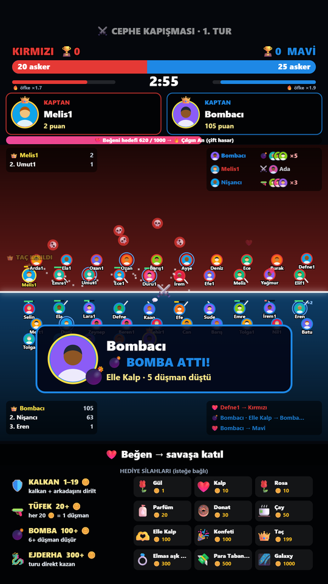
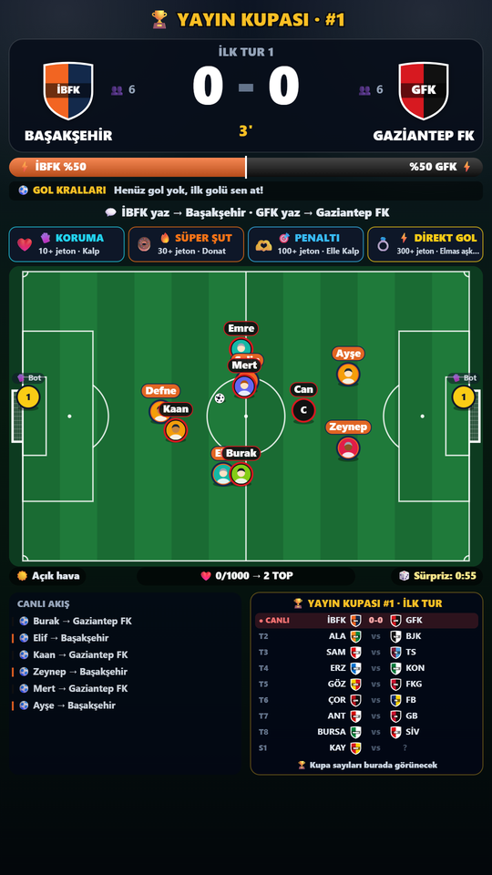
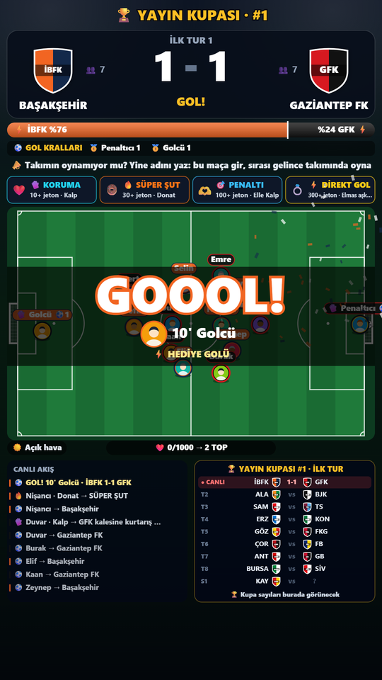
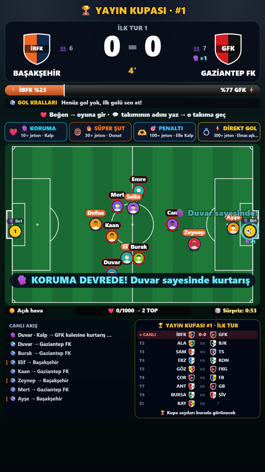
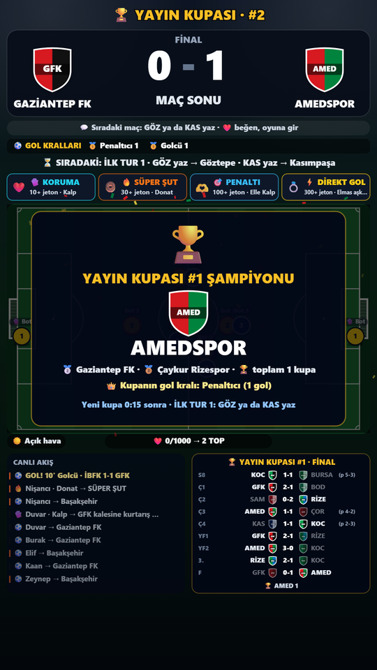

# ⚔️ Cephe Kapışması: TikTok LIVE için ücretsiz canlı yayın oyunları

İzleyicilerin beğeni, yorum ve hediyeyle oynadığı dikey (1080×1920) iki canlı yayın oyunu. Kendi bilgisayarında
çalışır. Ücretli bir servis, abonelik ya da API anahtarı gerektirmez. Açık kaynaktır (MIT).

- **⚔️ Cephe Kapışması:** Takım savaşı. Beğenen askere dönüşür, hediyeler silah olur.
- **⚽ Futbol Kupası:** 24 takımlı kupa. Beğenen ya da takımının adını yazan sahaya girer, hediyeler koruma,
  süper şut, penaltı ve gol olur. Maçı sesli anlatan bir spikeri var.

Hangi oyunun oynanacağını kontrol panelinden seçersin. Yayındaki oyun ekranı kendiliğinden değişir.

## ⚔️ Cephe Kapışması

<p align="center">
  
  
  
  
</p>

> Görüntüler örnek verilerle (demo izleyicileri) üretildi; gerçek kişi içermez.

### Nasıl oynanır?

| İzleyici ne yapar | Ne olur |
|---|---|
| ❤️ **Beğeni** atar | Profil fotoğrafı ve adıyla bir asker olarak savaşa girer (az kişili takıma) |
| 💬 **1** ya da **2** yazar | Kırmızı ya da Mavi takımı seçer |
| ❤️ Oyundayken beğenmeye devam eder | Askeri iyileşir, takımının hasarı (öfkesi) artar |
| ➕ Takip eder | 🛡️ bir kalkan kazanır |
| 🌹 **1–19 jeton** hediye (Gül, Kalp, Rosa) | 🛡️ Kalkan + düşen bir takım arkadaşını diriltir |
| 🔫 **20+ jeton** (Parfüm, Donat, Çay) | Tüfek: her 20 jeton için karşı takımdan 1 kişi düşer |
| 💣 **100+ jeton** (Elle Kalp, Konfeti, Taç, Corgi) | Bomba: 6 kişi ve üstü düşer |
| 🐉 **300+ jeton** (Elmas aşk yüzüğü, Para Tabancası) | Ejderha: turu direkt kazandırır |

- **Tur akışı:** 15 sn hazırlık → 3 dk savaş → 12 sn ara. Her yeni turda herkes oyundan çıkar, tekrar beğenip
  gelir.
- **Kazanan:** Süre bitince sahada en çok askeri kalan takım kazanır. Bir takım tükenirse 5 saniyelik "son
  şans" sayacı başlar.
- **Ön saf:** Askerler kendiliğinden kılıçla dövüşür. Düşen izleyici 10 sn sonra beğeniyle geri döner.
- **👑 Kaptan sıralaması:** 1 jeton = 1 puan, her düşürme +1 puan. Eşit puan alanlar aynı sırayı paylaşır.
  Kaptanlar profil fotoğrafıyla ekranda görünür, tacı bir vuruşa fazladan dayanır.
- **Beğeni hedefi:** Her 1000 beğenide 10 sn çift hasar.
- **🤖 Botlar:** İzleyici azken boş takımları "Bot" adlı askerlerle doldurur, gerçek izleyici geldikçe çekilirler.
- **Ekran öğeleri:** Düşürme akışı, büyük profil fotoğraflı hediye kartı, efektler (namlu alevi, patlama,
  ejderha alevi) ve kodla üretilen sesler.

Bütün eşikler, süreler ve seçenekler kontrol panelinden değiştirilebilir.

## ⚽ Futbol Kupası

<p align="center">
  
  
  
  
</p>

> Görüntüler örnek verilerle (demo izleyicileri ve botlar) üretildi; gerçek kişi içermez.

### Nasıl oynanır?

| İzleyici ne yapar | Ne olur |
|---|---|
| ❤️ **Beğeni** atar | Profil fotoğrafı ve adıyla sahaya girer: takımı oynuyorsa takımına, yoksa oyuncusu az olan tarafa |
| 💬 Takımın **kısa adını ya da adını** yazar (GS, FB, "fener", "sivas") | O takıma geçer. Maç sırasında 30 saniyede bir değiştirebilir. "1" ve "2" de olur |
| 💬 O an oynamayan bir takımı yazar | Bu maça misafir olarak girer; kendi takımının maçı gelince oraya kendiliğinden geçer |
| ❤️ Beğeni ve 💬 yorum | Takımının gücünü artırır: güçlü takım daha hızlı koşar, daha isabetli vurur |
| 🎁 **1–9 jeton** (Gül) | Takıma güç; birikince süper şuta dönüşür |
| 🧤 **10–29 jeton** (Kalp, Rosa, Parfüm) | **Koruma:** kaleci sıradaki isabetli şutu mutlaka kurtarır (en fazla 3 hak birikir) |
| 🔥 **30+ jeton** (Donat, Çay) | **Süper şut:** top hediyeyi atana gelir, sert ve isabetli bir şut çeker |
| 🎯 **100+ jeton** (Elle Kalp, Konfeti, Taç) | **Penaltı:** hediyeyi atan penaltıyı kullanır |
| ⚡ **300+ jeton** (Elmas aşk yüzüğü, Para Tabancası) | **Direkt gol:** durdurulamaz, gol hediyeyi atana yazılır (300'ün her katı bir gol, en fazla 3) |

- **Kupa:** 24 takımın hepsi oynar; kurada 8 takım ilk turu bay geçer. Sonra son 16, çeyrek final, yarı final,
  üçüncülük maçı ve final. Kısaltmak istersen panelden her kupada 16 ya da 8 takım (kurayla) seçilebilir.
- **Maç:** 10 sn maç öncesi, 150 sn maç (ekranda 90 dakika), 14 sn ara. Berabere biten maç penaltı atışlarıyla biter.
- **🎙️ Spiker:** Gol atanın adını, skoru ("Galatasaray bir sıfır öne geçti!"), maç başı geri sayımı, atakları,
  kurtarışları ve hediyeleri sesli söyler. Bilgisayarın kendi Türkçe sesini (Windows "Microsoft Tolga") kullanır:
  internet gerekmez, izleyici adları dışarı gönderilmez. Bilgisayarda Türkçe ses yoksa
  **Ayarlar → Zaman ve dil → Konuşma** bölümünden eklenebilir; panelden kapatılabilir.
- **Gol kralları ve kupa sayıları** ekranda görünür; botların golleri gol krallarına yazılmaz.
- **Hava ve sürprizler:** Her maç yağmur, kar, sis ya da rüzgar olabilir; maç içinde sahaya köpek girmesi,
  ışıkların gitmesi gibi sürprizler olur.
- **Beğeni hedefi:** Her 1000 beğenide 20 saniye boyunca sahada 2 top olur.
- **🤖 Botlar:** İzleyici azken her takımda en az 5 oyuncu olsun diye botlar oynar; gerçek izleyici geldikçe
  çekilirler. Takım tamamen izleyiciyle dolana kadar kaleyi bot tutar.

**Takımlar:** Varsayılan liste 2026-27 Süper Lig'in 18 takımı ile 1. Lig'den Sivasspor, Bursaspor, Antalyaspor,
Kayserispor, Fatih Karagümrük ve Bodrumspor. Kulüp adları yalnızca metin olarak kullanılır, logo yoktur; armalar
oyunun çizdiği basit kalkanlardır. Bu proje kulüplerle bağlantılı değildir. Adlar, kısa adlar ve renkler panelden
değiştirilebilir.

## Kurulum (Windows)

1. [Node.js](https://nodejs.org/tr/download) **LTS** sürümünü kur (20 veya üstü).
2. Bu sayfada **Code → Download ZIP** ile indir ve bir klasöre çıkar.
3. **`kurulum.bat`** dosyasını çift tıkla. Paketleri sabit sürümleriyle kurar; Node yoksa indirme sayfasını
   açar.
4. **`baslat.bat`** dosyasını çift tıkla. Kontrol paneli tarayıcıda açılır (`http://localhost:5077`).
   Siyah pencere yayın boyunca açık kalmalı.

Panelin en üstündeki **"Yayın öncesi kontrol"** listesi neyin eksik olduğunu gösterir.

## Yayına ekleme

### A) TikTok LIVE Studio (önerilen)

LIVE Studio'nun **Bağlantı** kaynağı yalnızca internetteki `https://` adresleri kabul ediyor. Bu yüzden oyun
ekranını ücretsiz bir Netlify sayfası olarak yayınlıyorsun; sayfa bilgisayarındaki oyuna bağlanır.

1. **`yayin-sayfasi-hazirla.bat`** dosyasını çalıştır. `yayin-sayfasi` klasörü ve Netlify Drop sayfası açılır.
2. Netlify'a giriş yap (ücretsiz) ve `yayin-sayfasi` klasörünü sürükleyip bırak. Netlify sana
   `https://...netlify.app` ile biten bir adres verir.
3. Kontrol panelinde **2 · Yayına ekle** bölümüne bu adresi yapıştır ve **Kaydet**'e bas.
4. LIVE Studio'da:
   - Studio görünümünü **dikey** yap.
   - **Kaynak ekle → Bağlantı** seç, Netlify adresini yaz.
   - **Özel çözünürlük**ü aç: **1080 × 1920**.
   - **Sesi aç** ve **Her zaman aktif tut** açık olsun.

Oyunun kodunu güncellediğinde 1. adımı tekrarla ve klasörü Netlify'da kendi sitenin **Deploys** sekmesine
sürükle; adres aynı kalır.

### B) OBS

**Kaynaklar → + → Tarayıcı** ekle, URL olarak `http://127.0.0.1:5077/oyun` yaz, boyutu **1080 × 1920** yap.
"OBS ile sesi kontrol et" seçeneğini aç.

### C) Pencere yakalama (yedek)

**`oyun-penceresi.bat`** oyunu ayrı bir pencerede açar. LIVE Studio'da **Pencere yakalama** ile alabilirsin.
Görüntü daha az net olur; pencereyi simge durumuna küçültme.

## Yayına çıkış

1. Panelde **Oyun seçimi** bölümünden oyunu seç (Cephe Kapışması ya da Futbol Kupası).
2. TikTok'ta canlı yayını başlat.
3. Panelde TikTok kullanıcı adını yaz ve **Bağlan**'a bas. Şifre istenmez.
4. Durum "Canlı yayına bağlı" olunca hazırsın. Telefondan beğeni atıp kendini sahada görebilirsin.

Yayında **yalnızca bir oyun ekranı** açık olsun (ör. LIVE Studio'daki). Her oyun ekranı maçı kendisi oynatır;
ikinci bir ekran (ör. tarayıcı sekmesi) açarsan orada başka bir maç oynanır ve panel karışır.

**Demo akışı** ile yayından önce sahte izleyicilerle prova yapabilirsin. Demo açıkken ekranda büyük bir **DEMO**
yazısı çıkar. Canlı yayında demoyu kapalı tut, sahte hediye göstermek izleyiciyi yanıltır.

## Güvenlik ve gizlilik

- Sunucu yalnızca bu bilgisayardan (`127.0.0.1`) erişilebilir; aynı ağdaki başka cihazlar erişemez.
- Panele yalnızca bu bilgisayardan erişilebilir. Bunun için Host ve Origin denetimi, CSRF başlığı ve CSP
  kullanılıyor.
- Netlify sayfası için tek bir izin açılır: **yalnızca panele kaydettiğin adres**, yalnızca oyun olaylarını
  okuyabilir ve spiker sesini isteyebilir. Bağlanma, ayar ve demo komutları yine yalnızca bilgisayarından
  verilebilir.
- Spiker cümleleri bilgisayarın kendi sesiyle, bilgisayarda seslendirilir. Metin dışarı gönderilmez; sesler
  yalnızca bellekte tutulur, diske yazılmaz.
- TikTok şifren ya da oturum bilgin istenmez. Herkese açık yayın, kullanıcı adıyla okunur.
- Bağlantı, resmî olmayan [tiktok-live-connector](https://github.com/zerodytrash/TikTok-Live-Connector)
  kütüphanesiyle kurulur. Kütüphane, bağlantı imzası için yayıncı adını **Euler Stream** adlı aracı servise
  gönderir. TikTok bir şeyi değiştirirse bağlantı geçici olarak bozulabilir.
- Ayarlar `data/` klasöründe, oturum sıralaması tarayıcıda tutulur. İzleyici adları sunucuda saklanmaz.

## Kurallar ve uyarılar

- TikTok'ta canlı yayın açmak ve hediye göndermek **18 yaş ve üstü** içindir.
- Hediye için ısrar etme ve hediye karşılığında gerçek ödül vaat etme. "Gül: kalkan" gibi nötr açıklamalar kullan.
- Botlar ekranda "🤖 Bot" olarak görünür; izleyici sayısını şişirmek için kullanılmaz.
- Yayında konuşmak (mikrofon) TikTok'un yayını "düşük kaliteli" saymasını önlemeye yardım eder.

## Sık sorulanlar

- **LIVE Studio "Doğru URL'yi girin" diyor:** `localhost` ya da `127.0.0.1` adresleri kabul edilmiyor. Netlify
  yolunu (A) kullan.
- **Ekranda "Oyun sunucusuna bağlanılamadı" yazıyor:**
  - `baslat.bat` açık mı?
  - Netlify adresi panele kayıtlı mı?
  - Chrome'da açtıysan "yerel ağ" izni istendi mi?
- **Hediye eşiklerini değiştirmek istiyorum:** Panelde **Ayarlar → Hediyeler (jeton)** (Cephe Kapışması) ya da
  **Ayarlar → Futbol Kupası**. Yanında yaklaşık TL karşılığı da görünür.
- **Spiker konuşmuyor:**
  - Panelde **🎙️ Spiker** açık mı?
  - LIVE Studio'da "Sesi aç", OBS'te "OBS ile sesi kontrol et" açık mı?
  - Bilgisayarda Türkçe ses var mı? (**Ayarlar → Zaman ve dil → Konuşma**)
- **Tarayıcıdaki oyun ile yayındaki farklı maç gösteriyor:** Her oyun ekranı kendi maçını oynatır. Yayında yalnızca
  bir oyun ekranı açık tut.

## Tanıtım görüntüsü üretme

`node araclar/tanitim-kaydet.mjs tanitim cikti --fps 60` komutu oyunu bot ve demo izleyicileriyle kare kare
oynatıp tam çözünürlükte görüntü üretir. Ekranda oynatmadığı için takılma olmaz. Kareleri ffmpeg ile videoya
çevirebilirsin. Senaryolar: `gif`, `tanitim`, `katilim`, `silahlar`, `ejderha`, `siralama`, `botlar`.

## Geliştirme

```
npm test     # testler: olay çevirisi, sunucu güvenliği, oyun kuralları, futbol kupası, spiker
npm start    # sunucuyu başlat
```

- `server.js`: yerel sunucu (yalnızca Node, ek çatı yok)
- `src/`: TikTok bağlantısı, ayarlar, demo, hediye kataloğu, spiker sesi (`spiker.js`)
- `public/oyun/`: Cephe Kapışması motoru (`motor.js`), çizim (`cizim.js`), sesler (`ses.js`)
- `public/futbol/`: Futbol Kupası motoru (`motor.js`), çizim (`cizim.js`), spiker (`spiker.js`), sayfa (`ana.js`)
- `public/panel.*`: kontrol paneli

## Lisans

[MIT](LICENSE). Bu proje TikTok ya da ByteDance ile ve futbol kulüpleriyle bağlantılı değildir; TikTok ve kulüp
adları sahiplerinin ticari markalarıdır.

---

### English

**Cephe Kapışması** is a pair of free, open-source interactive games for TikTok LIVE. Pick one in the control panel.

- **Team battle:** Viewers **like** to join as a soldier with their profile photo and type **1/2** to pick a team.
  Gifts become weapons: shield, rifle, bomb and a dragon that wins the round. Captain ranking, like goal and bots
  for small audiences are included.
- **Football cup:** A 24-team knockout cup (8 teams get a first-round bye). Viewers join by liking or by typing
  their team's name. Gifts give a guaranteed keeper save, a power shot, a penalty or a direct goal. A spoken
  commentator (offline Windows Turkish voice) calls goals with the scorer's name and the score. Club names are
  plain text only, with no logos, and can be changed in the panel.
- It runs locally on Node.js. Add it to TikTok LIVE Studio through a free Netlify page (the Link source only
  accepts public `https://` URLs), or add it to OBS as a browser source.

Setup: install Node.js LTS → `kurulum.bat` → `baslat.bat`. The UI is in Turkish.
